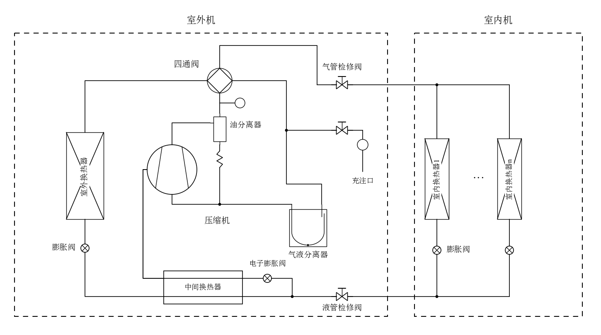
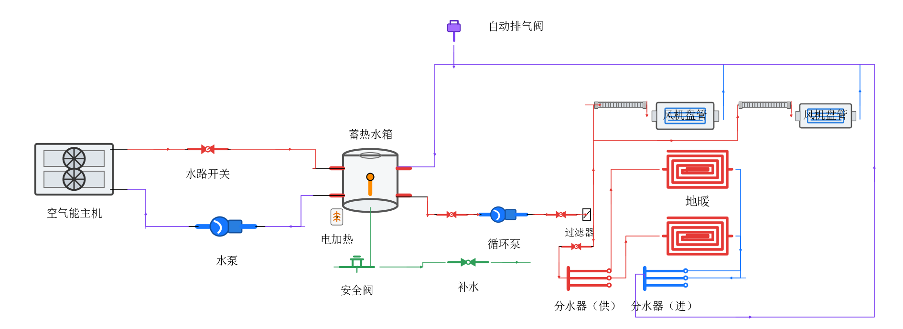
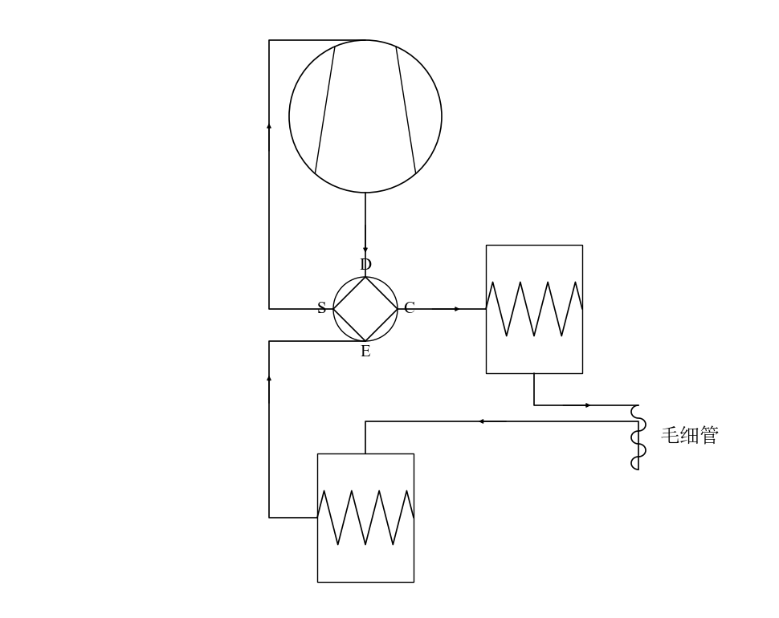
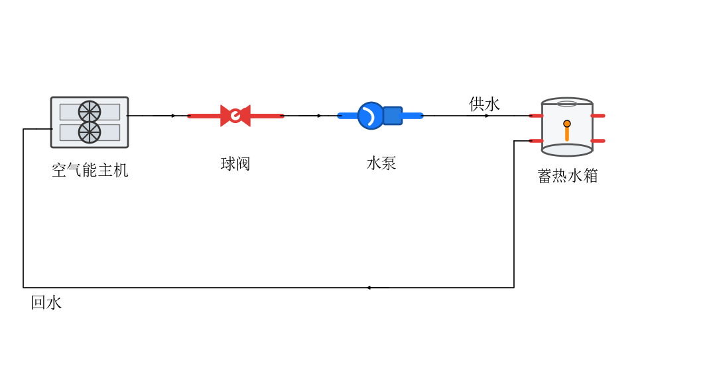

# rrplot —— 通用制冷循环/HVAC 示意图库

[](https://github.com/xiaenbaba/cycle-plot/actions/workflows/ci.yml)
[](https://www.python.org/)
[](LICENSE)

用 Matplotlib 按坐标拼装原理图:放置部件、走线式连管、随线标注状态点与
T/P 传感器圆圈,一键输出 PNG / PDF / SVG。坐标 1:1 对应画布像素(x 向右,
y 向下),所见即所得。

**版本：** 1.3.0
**依赖：** Python 3.9+, matplotlib, numpy



更多示例见 [`examples/`](#示例)。

## 安装

仅依赖 numpy + matplotlib。克隆仓库后本地安装(推荐,可省去示例脚本里的
`sys.path` 样板):

```powershell
pip install -e .
```

不安装也可用:在仓库根目录下直接 `import rrplot`。

从旧版 `cycleplot` 升级时,旧包名仍提供兼容导入;新代码建议统一使用
`rrplot`。

跑回归测试(CI 覆盖 ubuntu/windows × Python 3.9/3.12/3.13):

```powershell
pip install -e ".[test]"
python -m pytest
```

`tests/test_rrplot.py` 也可以直接 `python tests/test_rrplot.py` 跑,
不带 pytest 环境也能用。

静态检查(CI 里跑同一条):

```powershell
ruff check rrplot tests examples server
```

## 浏览器编辑器

在仓库根目录启动本机服务：

```powershell
.\.venv\Scripts\python.exe server\run.py
```

打开 <http://127.0.0.1:8765>，可编辑普通热泵、带储液器的普通热泵、EVI 过冷器、FTVI 闪蒸罐和 EVI 中间换热器模板，放置图元、连接端口、
调整折点和标签，保存 JSON，并导出 PNG/SVG/PDF。前端使用原生 SVG，
服务使用 Python 标准库，无需安装 Node.js、npm 或图编辑器框架。

详细操作见 [Web 使用说明](web/README.md)，设计与验收记录见
[Web 项目方案](WEB_PROJECT_PLAN.md)。首版面向本机单用户，尚不支持自动避障和全图元库。

## 快速上手

```python
from rrplot import Diagram, parts
from rrplot.parts import make_heat_exchanger

d = Diagram(width=1491, height=1055)
comp = d.add(parts.compressor, "压缩机", loc=(330, 140))
cond = d.add(make_heat_exchanger(180, 90, shape="rect_zigzag7"),
             "冷凝器", loc=(945, 140))

d.pipe(cond["bottom"], comp["suction"], via=[("e", 200), ("n", 105)],
       states=[("1", 0.5)])
d.save("out.png")     # 也支持 .pdf / .svg 矢量输出
```

完整教程(含部件速查表、标注语法、排错)见 `docs/tutorial.rst`;
坐标系与走线算法的原理见 `docs/design.rst`。

## 核心概念

**Diagram** 是画布。`add(part, label, loc, **style)` 放置部件返回 Node;
`node["端口名"]` 取得带绝对坐标与外法向的端口;`pipe(a, b, via, states,
head_at, color)` 连线。

- 坐标 1 单位 = 1 像素,x 向右、y 向下;`loc` 是部件中心,`save()` 默认裁边,
  需要严格 `width × height` 传 `tight=False`。
- `via` 三种写法混用:`("e", 200)` 走到 x=200;直接给 `(x, y)` 折点;裸
  字符串 `"e"` 走一个默认步长。方向令牌支持 e/w/n/s/right/left/up/down
  与中文名。
- 任意折点自动直角正交化(`_orthogonalize`);端口邻段 ≤10px 的错位视为
  笔误自动吸附,消除接缝碎块(`_fit_end`)。
- `states` 指定随线标注:`("1", 0.5)` 状态点编号;`{"text": "T_1", "at":
  0.3}` 局部处 T/P 传感器(自动识别字母开头文本,画成圆圈);随线箭头由
  `head_at` 控制位置,默认 `(0.55,)`,`head=False` 关闭。
- 两个端口平面不在一个水平/竖直线时,管线默认从端口法向出入。
- 在 Jupyter 中把 `Diagram` 实例放在单元格末尾即内嵌显示(SVG);
  连管拿不准时先 `d.debug()` 叠加端口点/法向箭头/拐点标记;
  `save("out.png", "out.svg")` 可一次输出多种格式。修改节点位置或样式后,
  调用 `d.clear_render().render()` 重建图层。

## 部件库(`rrplot.parts`)

按名字取直接实例:`compressor`、
`separator_utube`(U 形管气液分离器)、`oil_separator`(油分离器)、
`capillary`(毛细管)、`intermediate_hex`(中间换热器,过冷器/经济器
同体:矩形 + 上下两条通道线,主路 `main_in`/`main_out` 下侧、副路
`sub_in`/`sub_out` 上侧,逆流)、`four_way_round`(圆体菱形四通阀,端口
exhaust/condenser/evaporator/suction,自带 D/S/C/E 口别标注)、
`vessel`(闪发罐,胶囊形上下封头 + 液位线,端口
top/bottom/left/right/vapor)、`globe_valve`(截止阀,左右对顶沙漏 + 阀杆
(止于中点) + 手轮横杆,端口 in/out)、`solenoid_valve`(电磁阀,圆体 + 圆内 X +
顶部电磁引线与横杠,端口 in/out)、`expansion_valve_eng`(电子膨胀阀工程
画法,电磁阀体去掉引线与横杠,端口 in/out)、`expansion_valve_x`(膨胀阀
圆 + 内接 X,端口在圆周,orient="h"/"v" 水平/竖直通用)、`bowtie_valve` 系
(对顶三角阀:裸阀/穹顶膨胀阀/Σ 电磁阀/T 形截止阀,`actuator` 切换,端口 in/out)、
`check_valve`(单向阀,实心
三角指向流通方向 + 尖端挡条,`check_valve_w` 为反向实例,端口 in/out)、
`line_filter`/`filter`(过滤器,矩形 + 菱形网格,端口 in/out;`filter`
会覆盖 Python 内置名,新代码优先 `line_filter`)等。蒸发器/冷凝器等
换热器不分专用图元,用 `make_heat_exchanger(w, h, shape=...)` 生成,
端口 left/right/top/bottom,label 自定("蒸发器"/"冷凝器")。

中间换热器也支持竖直通道:
`make_intermediate_hex(w=160, h=220, orient="v")`。
主路右侧上进下出,副路左侧下进上出;`w`、`h` 始终为外壳宽、高。
默认 `orient="h"` 保持原来的水平通道布置。竖直示例见 `examples/evi_cycle.py`。

尺寸不合适时用工厂生成:

```python
from rrplot.parts import make_compressor, make_heat_exchanger
from rrplot.parts import (make_expansion_valve_x, make_four_way_round,
                             make_globe_valve, make_vessel,
                             make_solenoid_valve)
```

压缩机 `style` 支持 圆形/方形(圆体双弦 / 胶囊壳体),换热器
`shape` 支持 rect_diag/rect_x/rect_zigzag7,
详见各自 docstring。特殊端口定义可用 `make_partial(part, ports=..., dirs=...)`
从现有部件派生。

## HVAC 符号族(`rrplot.hvac`)

`references/hvacsvg/symbols` 全部 17 个 SVG 已转成代码图元,与 SVG 原件
逐像素一致:`heat_pump`、`water_pump`、`thermal_tank`、`fan_coil`、
`floor_heating`、`supply_manifold`/`return_manifold`(分水器)、球阀/排
水阀/补水阀/安全阀/自动排气阀/电加热/波纹管等。

工厂参数:`scale` 整体缩放、`moves` 覆盖连接点坐标、`bridge` 在边缘连
接点内侧补引管、`label_dy` 调标签位置。也可用
`rrplot.svgparts.load_svg_part(path, ...)` 直接加载新 SVG。

<details>
<summary>看图:空气能供暖系统(带水箱)/ 四通阀圆体回路 / SVG 符号直接加载 / 多联机(VRF)</summary>






</details>

## 示例

`examples/` 各图配套同名 `.py` 与同名 `.png`,可对照学习连管与标注技巧:

| 文件 | 内容 |
| --- | --- |
| vrf_multisplit.py | 多联机(VRF)系统图(室外机 + 室内机 1…n,参考图复刻) |
| ftvi_cycle.py | FTVI 闪发罐喷气增焓系统图(电子膨胀阀节流) |
| evi_ftvi_layout.py | 按 FTVI 版式重排的 EVI 过冷器喷气增焓(过冷器替代闪蒸罐) |
| evi_cycle.py | 多联机 / VRF 常见的 EVI 经济器喷气增焓(主路双级节流) |
| evi_subcooler_cycle.py | 普通热泵常见的 EVI 过冷器式喷气增焓(带电磁阀) |
| evi_economizer_cycle.py | 普通热泵 EVI 经济器竖直排布(主路上下贯通,喷气支路左右贯通) |
| compressor_symbols.py / heat_exchanger_shapes.py | 符号速观 |
| hvac_system.py / hvac_system_notank.py | 空气能供暖系统(带/无水箱) |
| hvacsvg_demo.py | `load_svg_part` 直接加载 SVG 符号 |
| four_way_round_demo.py | 四通阀圆体回路演示 |
| separator_utube_demo.py | U 形管气液分离器图元演示(镜像/翻转可选) |
| globe_valve_demo.py | 截止阀图元演示(左右对顶沙漏 + 手轮) |
| solenoid_valve_demo.py | 电磁阀图元演示(圆体 + 圆内 X + 电磁杠) |
| expansion_valve_eng_demo.py | 电子膨胀阀图元演示(工程画法,无执行机构) |
| check_valve_demo.py | 单向阀图元演示(实心三角,方向可选) |
| filter_demo.py | 过滤器图元演示(矩形 + 菱形网格) |

改完脚本直接重跑即覆盖同名 PNG:

```powershell
python examples/vrf_multisplit.py
python examples/hvac_system.py
```

## 字体

`rrplot.style` 依安装列表自动选 Times New Roman + 宋体栈
(`fontfamily` 交给 matplotlib 逐字回退),`use_font()` 打印当前生效字体。
需要临时隔离 Matplotlib 全局样式时可使用
`with rrplot.context(): ...`。

中文渲染成方框时按下面排查:

1. 调用 `use_font()` 看实际生效的字体族,确认栈里没有一个已安装;
2. Windows 装宋体/新宋体,macOS 装 Songti SC,Linux 装
   `fonts-noto-cjk` 或思源宋体,装完重启 Python 进程;
3. 自备字体文件时用 `matplotlib.font_manager.fontManager.addfont()`
   注册,再把族名加进 `rrplot.style.FONT_CANDIDATES` 头部。

## 目录结构

```
rrplot/     库本体:core(引擎)/ part(部件模型)/ parts(部件)/ hvac、svgparts(HVAC)/
               style(样式)/ _primitives(底层绘制)
examples/      每张图一个脚本 + 同名 PNG
tests/         pytest 回归测试(端口/走线/错误提示/全件渲染)
references/    早期原型脚本与 SVG 符号源文件
SVG/           export_parts_svg.py 导出的部件单图(可直接进论文/PPT)
docs/          Sphinx 文档:tutorial(上手)/ design(原理)/ api(自动提取)
```

## 文档

| 页面 | 内容 |
| --- | --- |
| `docs/tutorial.rst` | 上手教程:最小例子、via 三种写法、标注语法、部件速查表、排错 |
| `docs/design.rst` | 设计说明:坐标系约定、端口法向规则、走线三阶段算法、扩展部件的三条路 |
| `docs/api.rst` | 全部模块与函数的 API 参考(autodoc 自动提取) |

本地构建(0 警告):

```powershell
pip install -e ".[docs]"
python -m sphinx -b html docs docs/_build/html
```

生成的 `docs/_build/html/index.html` 即为可浏览的文档站点。

## 贡献

新增部件请在 `rrplot/parts.py` 里写绘制函数 + 端口表(或用
`make_partial` 派生),并在 `tests/test_rrplot.py` 补端口断言、
在 `examples/` 加一个演示脚本;提交前跑通 `python -m pytest` 与
`ruff check rrplot tests`。

## 许可

MIT,见 [LICENSE](LICENSE)。
